# GoLab

[简体中文](README.zh-CN.md) · [API reference](docs/api.md) · [OpenAPI](openapi.yaml) · [Contributing](CONTRIBUTING.md)

GoLab is a self-hosted platform for feature flags, gradual rollouts, and A/B experiments. It also versions and gates AI resources such as prompts, skills, and agent specifications. The control plane, web console, and HTTP API can run as a standalone service or inside another Go service. This repository is named **Grayling**; the application and Go package remain **GoLab**.


## What it includes

- **Feature delivery:** targeting rules, deterministic percentage allocation, immutable published revisions, rollback, approval workflows, audit logs, and tenant-scoped access.
- **Experimentation:** pre-registered A/B tests, exposure and conversion collection, sample-ratio mismatch checks, guardrails, reports, and staged rollout plans with manual or automatic progression.
- **AI resource control:** versioned prompts, skills, and agent specifications; pinned versions, session-level configuration freeze, digest verification, and emergency revocation.
- **Clients:** local evaluation with the Go SDK, remote evaluation with Python and TypeScript SDKs, and an OpenFeature Go provider. An optional proxy supports remote evaluation and gateway integration.
- **Deployment choices:** embedded gonacos or external Nacos 3.2.1+ for configuration distribution; JSON file, pure-Go SQLite, or PostgreSQL for GoLab platform data. The web console is embedded and needs no frontend build.
- **OpenAI client compatibility:** optionally relay Chat Completions, including SSE streams, to a configured OpenAI-compatible upstream by changing only the client's `baseURL`.

## Quick start

Requires **Go 1.27 or newer** and `make`. From a clone of this repository:

```bash
git clone https://github.com/saker-ai/grayling.git
cd grayling
make run
```

Open <http://127.0.0.1:19080/>. On the first run, `make run` creates a local administrator password in `data/admin-password`; in another terminal, run `make show-admin-password` to view it. The password file and runtime data are ignored by Git. The server also prints a one-time global owner token when it creates the first owner. Store that token securely if you plan to use it.

`make run` listens on loopback and starts embedded gonacos on ephemeral loopback ports. Its default platform store is a JSON file under `data/`. To use SQLite for a persistent single-node installation:

```bash
make run RUN_ARGS='-sqlite data/golab.db'
```

For multi-replica PostgreSQL deployments, use `-pg` and a shared auth secret; see [platform storage](docs/storage.md) and [multi-replica writes](docs/多副本管理写入.md). Set `-nacos-url` to use an external Nacos service; see [external Nacos](docs/external-nacos.md) for credentials, permissions, and data layout. The storage flag selects GoLab's platform database; Nacos stores the published configuration separately.

## Use GoLab in your application

The root package is importable as `github.com/saker-ai/grayling`. `golab.Start` owns the stores and background jobs, while your service owns the HTTP listener and shutdown sequence. Mount `App.Handler()` for the API and console, or `App.APIHandler()` for the API alone. See the [complete embedding example](docs/embedding.md).

| Client | Evaluation path | Documentation |
| --- | --- | --- |
| Go SDK | Local evaluation from verified snapshots | [`pkg/sdk`](pkg/sdk), [API reference](docs/api.md) |
| OpenFeature Go provider | Local evaluation through the Go SDK | [`pkg/ofprovider`](pkg/ofprovider), [provider compatibility](docs/OpenFeature-Provider-规范验收.md) |
| Python SDK | Remote evaluation with bounded cache and polling | [Python SDK](sdk/python/README.md) |
| TypeScript SDK | Remote evaluation with bounded cache and polling | [TypeScript SDK](sdk/typescript/README.md) |
| Standalone proxy | Remote evaluation, SSE, and event collection relay | [Proxy and API reference](docs/api.md) |

The GoLab API issues separate credentials for administration, SDK reads, and event collection. Do not expose administrative credentials to browser clients.

### OpenAI-compatible Chat Completions

Start with `make run RUN_ARGS='-openai-upstream-url https://api.openai.com/v1 -openai-workspace acme -openai-environment prod'` after creating that workspace, environment, a published JSON flag named `openai-chat`, a pinned prompt, and a model allowlist entry. Point an existing OpenAI client at `http://127.0.0.1:19080/v1`; keep its existing upstream API key and request, including `stream: true`. GoLab evaluates the flag, selects its allowlisted `modelRef`, prepends the pinned `promptRef` as a system message, checks revocation, and forwards the original Bearer key and JSON or SSE response. See [API details](docs/api.md).

## Architecture

```mermaid
flowchart LR
    Admin[Web console / Admin API] --> Core[GoLab]
    Core --> DB[(JSON / SQLite / PostgreSQL)]
    Core --> Nacos[(Embedded gonacos / external Nacos)]
    GoSDK[Go SDK / OpenFeature] -->|snapshot sync and events| Core
    Remote[Python / TypeScript / proxy] -->|evaluation and events| Core
    AI[AI application] -->|pinned resource and revocation checks| Core
```



Published flag and segment documents are immutable; a manifest identifies the active revisions. SDKs verify snapshots before replacing local state. The platform database keeps experiments, tokens, audit entries, events, and AI resource indexes. [Technical design](docs/技术方案.md) explains the publication and evaluation contracts.

## Deployment notes

- The GORM SQLite and PostgreSQL schemas do not read the former pgx schema. Plan an explicit migration for an existing installation; see [storage](docs/storage.md).
- External Nacos mode stores AI versions in Nacos Config, not in the native Nacos AI Registry. It does not migrate embedded gonacos data automatically; see [external Nacos](docs/external-nacos.md).
- Use HTTPS for a console or management API reachable beyond loopback. Keep embedded gonacos listeners private and protect production auth secrets. See the [threat model](docs/threat-model.md).
- Native Nacos SDK access to embedded gonacos has its own compatibility and network constraints; see the [client matrix](docs/Nacos原生客户端.md). Validate capacity and joint backup/restore with your deployment topology before production use.

## Development and tests

```bash
make build
GOLAB_TEST_PG_SKIP=1 GOWORK=off go test -short ./ ./cmd/... ./internal/... ./pkg/... ./web
make sdk-test
make license-check
```

`GOWORK=off` prevents a parent Go workspace from overriding the pinned gonacos dependency. The fast test command skips environment-dependent acceptance suites. Full integration tests can use Docker or explicit PostgreSQL/Redis test endpoints; see [test guidance](CONTRIBUTING.md) and the [implementation record](docs/实施状态.md). CI covers build, vet, race tests, PostgreSQL integration, SDK tests, and license evidence.

## Documentation

| Topic | Guide |
| --- | --- |
| API endpoints | [API reference](docs/api.md) · [OpenAPI specification](openapi.yaml) |
| Embedding in Go | [Embedding guide](docs/embedding.md) |
| Storage | [JSON, SQLite, and PostgreSQL](docs/storage.md) |
| External Nacos | [Setup and limitations](docs/external-nacos.md) |
| Security | [Threat model](docs/threat-model.md) · [Vulnerability reporting](SECURITY.md) |
| Design and verification | [Technical design](docs/技术方案.md) · [Implementation record](docs/实施状态.md) |

## Contributing and license

Contributions are welcome. See [CONTRIBUTING.md](CONTRIBUTING.md) for setup and checks, and [SECURITY.md](SECURITY.md) for private vulnerability reports.

GoLab is licensed under [Apache-2.0](LICENSE). Third-party attribution and the pinned dependency license inventory are in [THIRD_PARTY_NOTICES.md](THIRD_PARTY_NOTICES.md) and [`third_party/licenses.json`](third_party/licenses.json). Run `make release-check` before redistributing binaries.
