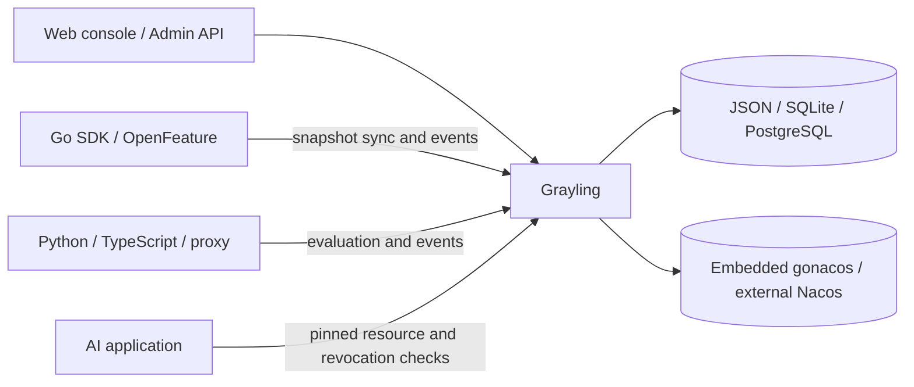

# Grayling

[简体中文](README.zh-CN.md) · [API reference](docs/api.md) · [OpenAPI](openapi.yaml) · [Contributing](CONTRIBUTING.md) · [Growth Copilot read-only command and contracts](docs/growth-copilot.md)

Grayling is a self-hosted platform for feature flags, gradual rollouts, and A/B experiments. It also versions and gates AI resources such as prompts, skills, and agent specifications. The control plane, web console, and HTTP API can run as a standalone service or inside another Go service. This repository is named **Grayling**; the application and Go package remain **Grayling**.

The optional `bin/grayling-growth-agent review` and `prepare` commands and `internal/growth` library read aggregate evidence and validate
versioned proposal JSON for human review. Missing/mismatched/HOLD evidence and
missing implementation attestations block readiness. For example, a complete
proposal paired with local HOLD evidence returns `needs_data`, even if its text
asks for approval. Readiness never approves or submits an experiment; sample-plan
inputs and attestations do not establish statistical adequacy or real instrumentation.
Build with `make build` (or `make build-go`), supply an explicit trusted API origin,
workspace/environment IDs and a bearer token environment variable. See the
[setup, command usage, exit codes and trust boundaries](docs/growth-copilot.md#read-only-review-command)
and [proposal JSON example](docs/growth-copilot.md#proposal-contract). The optional pure
[`CompileCreateRequest` library](docs/growth-copilot.md#optional-create-request-compiler)
is exposed through `prepare --proposal proposal.json --settings preparation.json`
with the same explicit scope, credential and timeout flags as `review`. It exports
two-variant fixed-split create JSON from evidence-ready proposals and a separate
bounded operator settings file with explicit owner/statistical/guardrail settings. It preserves exact metric
references and keeps proposal/evidence metadata separate. It adds no CLI
submission or platform writes; human approval, targeting/binding checks and
existing Grayling validation remain required.

Optionally add [`prepare --review-record review-record.json`](docs/growth-copilot.md#review-linked-preparation)
to link preparation to an exported approval for the exact proposal. Scope,
complete fingerprint, metric roles and copied evidence pins are checked before
HTTP access; fresh evidence must still pass every readiness/compiler check.
Review provenance is exported separately with `publicationAuthorized=false`.
The record remains caller-attested: it does not authenticate a reviewer, approve
separate preparation settings, establish historical readiness or authorize submission.

The pure [`RecordReview` library contract](docs/growth-copilot.md#pure-human-review-records)
pins the complete proposal with a deterministic SHA-256 fingerprint and accepts
separate caller-supplied reviewer, timestamp, rationale and approve/reject/request_changes
decisions. Stale content is rejected; approval requires existing evidence readiness,
while rejection/changes retain blockers. Records are caller-attested artifacts,
not authenticated authorization, durable audit storage or permission to submit/publish.
The offline `fingerprint --proposal FILE` command prints the proposal fingerprint;
`record-review --proposal FILE --review-input review.json` re-reads pinned evidence
with the same trusted connection flags as `review` and exports one record.
The separate bounded operator input supplies the expected fingerprint, decision,
reviewer, explicit timestamp and rationale. Exported records contain operator-supplied
review content and are not authenticated authorization. See
[review command usage](docs/growth-copilot.md#review-record-commands).
The one-shot [`monitor --manifest monitor.json` command](docs/growth-copilot.md#read-only-monitor-command)
reads the actual linked experiment with explicit epoch, registration and exact
primary/guardrail metric pins; an exact report evidenceVersion pin is optional.
It exports observed report provenance and bounded blocker/remediation codes,
keeping server verdicts separate from READY/HOLD/NEEDS_DATA. READY never
authorizes publication, and all requests remain GET-only. Local fixtures establish
conservative HOLD; durable monitoring and model generation
remain future work.

Read-only rollout observation is available through
`grayling-growth-agent rollout --manifest FILE --base-url ORIGIN --workspace ID --environment ID`.
The strict manifest pins workspace/environment, experiment ID, epoch and registration
version. One experiment GET exports bounded, allowlisted embedded plan state and recent
history, with observation availability separate from release state. Publication is never
authorized; completion does not establish a business win. See the
[rollout contract](docs/growth-copilot.md#read-only-rollout-observation).

The read-only [`bind-check` command](docs/growth-copilot.md#read-only-binding-readiness)
uses the same pinned operator manifest:
`grayling-growth-agent bind-check --manifest FILE --base-url ORIGIN --workspace ID --environment ID`.
It validates all nine binding prerequisites between two experiment reads and
rejects registration, scope or snapshot changes. Missing evidence or failed
prerequisites produce explicit blockers and exit 3. This is a non-atomic
observation that never authorizes binding or publication; output always includes
`publicationAuthorized=false` and excludes server detail prose.

The offline [`verify-review` command](docs/growth-copilot.md#offline-verify-review-command)
checks an exported human review against its proposal and explicit scope:
`grayling-growth-agent verify-review --proposal proposal.json --record review-record.json --workspace ws1 --environment env1`.
It accepts regular local files only (proposal 64 KiB, review 128 KiB), strictly
checks JSON and copied metric/evidence pins, and emits deterministic JSON with
`publicationAuthorized=false`. Exit codes are 0 for consistency, 2 for invalid
input, and 1 for output failure. It uses no credentials, network or persistence
and does not authenticate reviewers or prove historical readiness.

The offline [`verify-learning` command](docs/growth-copilot.md#offline-verify-learning-command)
compares an exported learning record with its original proposal and explicit scope:
`grayling-growth-agent verify-learning --proposal proposal.json --record learning-record.json --workspace ws1 --environment env1`.
It recomputes the complete fingerprint and checks copied provenance and metric roles.
The bounded summary preserves observation status; publication and business win remain
false. Verification establishes local consistency only, without authenticated
authorship, execution, freshness or causality.

The offline [`search-learning` command](docs/growth-copilot.md#offline-search-learning-command)
searches literal hypothesis/follow-up text in explicitly supplied exported learning
records within a required workspace/environment. It validates all bounded regular
files before output, preserves evidence-linked HOLD/NEEDS_DATA snapshots, and
rejects authorization claims. Results are caller-attested local artifacts; search
does not refresh evidence, access credentials/network, write an index or provide
authenticated journal storage or real pilot acceptance.

The read-only [`Reader.RecordLearning` library](docs/growth-copilot.md#read-only-learning-records)
pins the original proposal and links a caller-attested experiment through the
existing monitor. Records separate proposal baselines from observed report
provenance, preserve HOLD/NEEDS_DATA and server verdicts, and retain explicit
recorder, timestamp and bounded follow-ups. They prove neither execution nor a
business win; publication remains unauthorized. The GET-only
[`record-learning --proposal FILE --manifest FILE --learning-input FILE` command](docs/growth-copilot.md#record-learning-command)
exports one record using separately supplied operator inputs and the pinned proposal
fingerprint. No persistence is added.
Real Saker instrumentation, pilot evidence and durable workflows remain outstanding.


## What it includes

- **Feature delivery:** targeting rules, deterministic percentage allocation, immutable published revisions, rollback, approval workflows, audit logs, and tenant-scoped access.
- **Experimentation:** pre-registered A/B tests, exposure and conversion collection, sample-ratio mismatch checks, guardrails, reports, and staged rollout plans with manual or automatic progression.
- **AI resource control:** versioned prompts, skills, and agent specifications; pinned versions, session-level configuration freeze, digest verification, and emergency revocation.
- **Clients:** local evaluation with the Go SDK, remote evaluation with Python and TypeScript SDKs, and an OpenFeature Go provider. An optional proxy supports remote evaluation and gateway integration.
- **Deployment choices:** embedded gonacos or external Nacos 3.2.1+ for configuration distribution; JSON file, pure-Go SQLite, or PostgreSQL for Grayling platform data. The web console is an embedded React SPA whose built assets are committed to the repository, so `make run` works without Node.js.
- **OpenAI client compatibility:** optionally relay Chat Completions, including SSE streams, to a configured OpenAI-compatible upstream by changing only the client's `baseURL`.

## Quick start

Requires **Go 1.27 or newer** and `make`. From a clone of this repository:

```bash
git clone https://github.com/saker-ai/grayling.git
cd grayling
make run
```

Open <http://127.0.0.1:27002/>. `make run` starts in developer mode: the console signs itself in as the global owner, so there is no password to type and no password file is created. That convenience covers every visitor to the port, so it is for local work only — keep the listener off untrusted networks, or start without it (`make run DEV=0`, which generates `data/admin-password` and asks you to sign in with `make show-admin-password`). The password file and runtime data are ignored by Git. The server also prints a one-time global owner token when it creates the first owner. Store that token securely if you plan to use it.

`make run` binds `:27002` on every interface — the console and API are reachable from any network over plaintext HTTP, so put TLS termination in front before exposing them beyond a trusted network (override with `make run RUN_PORT=...`). Embedded gonacos still starts on ephemeral loopback ports. Its default platform store is a JSON file under `data/`. Before starting, `make run` automatically stops any process listening on `RUN_PORT`: it sends SIGTERM, waits up to 5 seconds, then uses SIGKILL if needed. This requires Python 3 and either `lsof` or `ss`. To use SQLite for a persistent single-node installation:

```bash
make run RUN_ARGS='-sqlite data/grayling.db'
```

For multi-replica PostgreSQL deployments, use `-pg` and a shared auth secret; see [platform storage](docs/storage.md) and [multi-replica writes](docs/多副本管理写入.md). Set `-nacos-url` to use an external Nacos service; see [external Nacos](docs/external-nacos.md) for credentials, permissions, and data layout. The storage flag selects Grayling's platform database; Nacos stores the published configuration separately.

## Use Grayling in your application

Flags and segments use a stable ASCII `key` for SDK calls and references. Use optional `displayName` (up to 128 Unicode characters) and `description` (up to 2048) for Chinese or other human-readable text. The console supports creating, editing, displaying and searching this metadata; changes follow the existing draft review and publish lifecycle.

The root package is importable as `github.com/saker-ai/grayling`. `grayling.Start` owns the stores and background jobs, while your service owns the HTTP listener and shutdown sequence. Mount `App.Handler()` for the API and console, or `App.APIHandler()` for the API alone. See the [complete embedding example](docs/embedding.md).

| Client | Evaluation path | Documentation |
| --- | --- | --- |
| Go SDK | Local evaluation from verified snapshots | [`pkg/sdk`](pkg/sdk), [API reference](docs/api.md) |
| OpenFeature Go provider | Local evaluation through the Go SDK | [`pkg/ofprovider`](pkg/ofprovider), [provider compatibility](docs/OpenFeature-Provider-规范验收.md) |
| Python SDK | Remote evaluation with bounded cache and polling | [Python SDK](sdk/python/README.md) |
| TypeScript SDK | Remote evaluation with bounded cache and polling | [TypeScript SDK](sdk/typescript/README.md) |
| Standalone proxy | Remote evaluation, SSE, and event collection relay | [Proxy and API reference](docs/api.md) |

The Grayling API issues separate credentials for administration, SDK reads, and event collection. Do not expose administrative credentials to browser clients.

### OpenAI-compatible Chat Completions

Start with `make run RUN_ARGS='-openai-upstream-url https://api.openai.com/v1 -openai-workspace acme -openai-environment prod'` after creating that workspace, environment, a published JSON flag named `openai-chat`, a pinned prompt, and a model allowlist entry. Point an existing OpenAI client at `http://127.0.0.1:27002/v1`; keep its existing upstream API key and request, including `stream: true`. Grayling evaluates the flag, selects its allowlisted `modelRef`, prepends the pinned `promptRef` as a system message, checks revocation, and forwards the original Bearer key and JSON or SSE response. See [API details](docs/api.md).

## Architecture



Published flag and segment documents are immutable; a manifest identifies the active revisions. SDKs verify snapshots before replacing local state. The platform database keeps experiments, tokens, audit entries, events, and AI resource indexes. [Technical design](docs/技术方案.md) explains the publication and evaluation contracts.

## Deployment notes

- The GORM SQLite and PostgreSQL schemas do not read the former pgx schema. Plan an explicit migration for an existing installation; see [storage](docs/storage.md).
- External Nacos mode stores AI versions in Nacos Config, not in the native Nacos AI Registry. It does not migrate embedded gonacos data automatically; see [external Nacos](docs/external-nacos.md).
- Use HTTPS for a console or management API reachable beyond loopback. Keep embedded gonacos listeners private and protect production auth secrets. See the [threat model](docs/threat-model.md).
- Native Nacos SDK access to embedded gonacos has its own compatibility and network constraints; see the [client matrix](docs/Nacos原生客户端.md). Validate capacity and joint backup/restore with your deployment topology before production use.

## Development and tests

```bash
make build
GRAYLING_TEST_PG_SKIP=1 GOWORK=off go test -short ./ ./cmd/... ./internal/... ./pkg/... ./web
make sdk-test
make license-check
```

`GOWORK=off` prevents a parent Go workspace from overriding the pinned gonacos dependency. The fast test command skips environment-dependent acceptance suites. Full integration tests can use Docker or explicit PostgreSQL/Redis test endpoints; see [test guidance](CONTRIBUTING.md) and the [implementation record](docs/实施状态.md). CI covers build, vet, race tests, PostgreSQL integration, SDK tests, and license evidence.

### Web console

The console is a React 19 + TypeScript SPA built with Vite, organized as a pnpm workspace of three packages: `web/` (Vite app, shell, hooks, and the Go embed), `web-pages/` (page, editor, and workbench components), and `web-client/` (fetch client and API types). Working on the frontend requires **Node.js 26+** and **pnpm 10**. `make build` runs the frontend build before compiling the binaries, and the resulting `web/static/` tree is embedded and committed to git — `make check-static` (also run in CI) fails if the committed tree drifts from a fresh build. For console iteration run `make dev-backend` (the normal server) and `make dev-frontend` (Vite dev server with hot reload, proxying the API to the backend) side by side. Frontend tests are vitest suites (`pnpm -r test`); `go test ./web/` drives the same suites plus Go-side preset re-validation.

## Documentation

| Topic | Guide |
| --- | --- |
| API endpoints | [API reference](docs/api.md) · [OpenAPI specification](openapi.yaml) |
| Embedding in Go | [Embedding guide](docs/embedding.md) |
| Storage | [JSON, SQLite, and PostgreSQL](docs/storage.md) |
| External Nacos | [Setup and limitations](docs/external-nacos.md) |
| Product and console roadmap | [Complete implementation plan](docs/产品与Web体验完整实施方案.md) (Chinese) |
| Growth experiments | [Scope](docs/增长实验规划.md) · [Domain implementation plan](docs/增长实验实施方案.md) (Chinese) |
| Admin console redesign | [UI/UX plan](docs/Web控制台重设计实施方案.md) · [Page specifications](docs/Web控制台页面规格与交付清单.md) (Chinese) |
| Security | [Threat model](docs/threat-model.md) · [Vulnerability reporting](SECURITY.md) |
| Design and verification | [Technical design](docs/技术方案.md) · [Implementation record](docs/实施状态.md) |

## Contributing and license

Contributions are welcome. See [CONTRIBUTING.md](CONTRIBUTING.md) for setup and checks, and [SECURITY.md](SECURITY.md) for private vulnerability reports.

Grayling is licensed under [Apache-2.0](LICENSE). Third-party attribution and the pinned dependency license inventory are in [THIRD_PARTY_NOTICES.md](THIRD_PARTY_NOTICES.md) and [`third_party/licenses.json`](third_party/licenses.json). Run `make release-check` before redistributing binaries.
