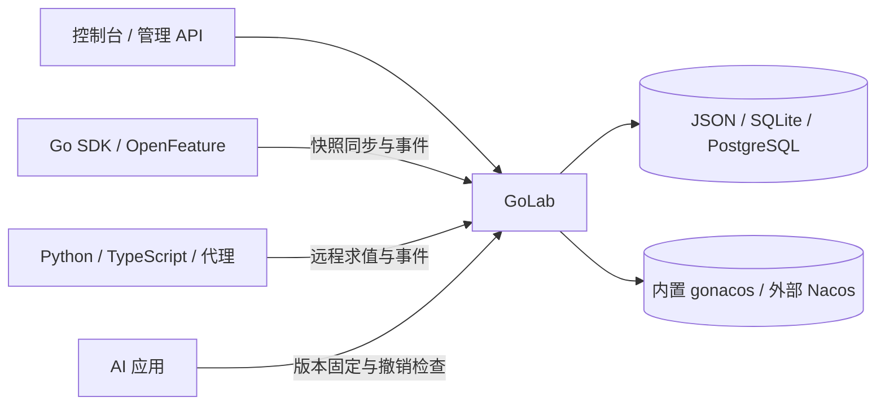

# GoLab

[English](README.md) · [API 参考](docs/api.md) · [OpenAPI](openapi.yaml) · [参与贡献](CONTRIBUTING.md)

GoLab 是可自托管的功能开关、渐进发布与 A/B 实验平台，也为 Prompt、Skill 和 AgentSpec 等 AI 资源提供版本管理与运行时门禁。控制面、Web 控制台和 HTTP API 可独立部署，也可嵌入现有 Go 服务。仓库名为 **Grayling**，应用和 Go 包仍称 **GoLab**。


## 能做什么

- **功能发布**：定向规则、确定性百分比分流、不可变发布版本、回滚、审批、审计与租户隔离。
- **实验分析**：预注册 A/B 实验、曝光和转化采集、样本比例偏差检查、护栏、报告，以及可人工或自动推进的分阶段发布计划。
- **AI 资源治理**：Prompt、Skill 和 AgentSpec 独立版本，固定版本、会话级配置冻结、摘要校验与紧急撤销。
- **客户端**：Go SDK 本地求值、Python/TypeScript SDK 远程求值、OpenFeature Go Provider，以及可独立部署的远程求值代理。
- **部署选择**：内置 gonacos 或外部 Nacos 3.2.1+ 分发配置；JSON 文件、纯 Go SQLite 或 PostgreSQL 保存 GoLab 平台数据。控制台内嵌，无需构建前端。
- **OpenAI 客户端兼容**：可选地将 Chat Completions（包括 SSE 流）转发到配置好的 OpenAI 兼容上游；客户端只需修改 `baseURL`。

## 快速开始

需要 **Go 1.27 或更新版本**和 `make`：

```bash
git clone https://github.com/saker-ai/grayling.git
cd grayling
make run
```

打开 <http://127.0.0.1:19080/>。首次运行会在 `data/admin-password` 创建管理员密码；另开终端运行 `make show-admin-password` 查看。密码文件和运行数据已被 Git 忽略。首次创建 owner 时，服务还会在日志中输出一次性全局 owner 令牌；需要使用时请妥善保存。

`make run` 默认只监听本机，内置 gonacos 使用本机随机端口。平台数据默认保存在 `data/` 下的 JSON 文件。单节点持久化可改用 SQLite：

```bash
make run RUN_ARGS='-sqlite data/golab.db'
```

多副本 PostgreSQL 部署使用 `-pg` 和共享认证密钥，参见[平台存储](docs/storage.md)及[多副本写入](docs/多副本管理写入.md)。使用 `-nacos-url` 可切换到外部 Nacos；凭证、权限与数据布局见[外部 Nacos](docs/external-nacos.md)。平台存储参数只选择 GoLab 的数据库；发布后的配置由 Nacos 单独保存。

## 接入 Go 服务与 SDK

根包可通过 `github.com/saker-ai/grayling` 导入。`golab.Start` 管理存储与后台任务，宿主负责 HTTP 监听和退出流程。挂载 `App.Handler()` 可提供 API 与控制台；只需 API 时挂载 `App.APIHandler()`。完整代码见[嵌入示例](docs/embedding.md)。

| 客户端 | 求值方式 | 文档 |
| --- | --- | --- |
| Go SDK | 验证快照后本地求值 | [`pkg/sdk`](pkg/sdk)、[API 参考](docs/api.md) |
| OpenFeature Go Provider | 通过 Go SDK 本地求值 | [`pkg/ofprovider`](pkg/ofprovider)、[兼容性](docs/OpenFeature-Provider-规范验收.md) |
| Python SDK | 远程求值、受限缓存与轮询 | [Python SDK](sdk/python/README.md) |
| TypeScript SDK | 远程求值、受限缓存与轮询 | [TypeScript SDK](sdk/typescript/README.md) |
| 独立代理 | 远程求值、SSE 与事件采集中继 | [代理与 API](docs/api.md) |

GoLab 分别签发管理、SDK 读取和事件采集凭证。浏览器客户端不应持有管理凭证。

### OpenAI 兼容的 Chat Completions

先创建工作空间 `acme`、环境 `prod`、已发布的 JSON Flag `openai-chat`、已固定版本的 Prompt 及模型白名单，再以 `make run RUN_ARGS='-openai-upstream-url https://api.openai.com/v1 -openai-workspace acme -openai-environment prod'` 启动。现有 OpenAI 客户端只需把 `baseURL` 改为 `http://127.0.0.1:19080/v1`，保留原有上游 API Key 和请求，包括 `stream: true`。GoLab 求值 Flag，使用其 `modelRef` 选择白名单模型，将 `promptRef` 的固定版本作为 system 消息插入，检查撤销，再透传原有 Bearer Key 和普通 JSON 或 SSE 响应。参见 [API 说明](docs/api.md)。

## 架构



Flag 和 segment 发布文档不可变，manifest 指向当前生效版本；SDK 验证快照后再原子替换本地状态。平台数据库保存实验、凭证、审计、事件与 AI 资源索引。发布和求值契约见[技术方案](docs/技术方案.md)。

## 部署边界

- 当前 GORM SQLite/PostgreSQL schema 不读取旧 pgx schema；已有部署需单独规划迁移，见[存储文档](docs/storage.md)。
- 外部 Nacos 模式把 AI 版本存入 Nacos Config，**不使用原生 Nacos AI Registry**，也不会自动迁移内置 gonacos 的数据，见[外部 Nacos](docs/external-nacos.md)。
- 控制台或管理 API 供非本机访问时须使用 HTTPS。内置 gonacos 应保留在私有网络，并妥善保管生产认证密钥，见[威胁模型](docs/threat-model.md)。
- 内置 gonacos 的原生 Nacos SDK 接入另有兼容性和网络限制，见[客户端矩阵](docs/Nacos原生客户端.md)。生产使用前应按实际拓扑验证容量和联合备份恢复。

## 开发与测试

```bash
make build
GOLAB_TEST_PG_SKIP=1 GOWORK=off go test -short ./ ./cmd/... ./internal/... ./pkg/... ./web
make sdk-test
make license-check
```

`GOWORK=off` 避免父级 Go workspace 覆盖固定的 gonacos 版本。快速测试会跳过依赖外部环境的验收套件；完整集成测试可使用 Docker 或显式指定 PostgreSQL/Redis 测试端点。参见[贡献指南](CONTRIBUTING.md)和[实施记录](docs/实施状态.md)。CI 配有构建、vet、race、PostgreSQL 集成、SDK 和许可证检查。

## 文档

| 主题 | 文档 |
| --- | --- |
| API | [API 参考](docs/api.md) · [OpenAPI](openapi.yaml) |
| 嵌入 Go 服务 | [嵌入指南](docs/embedding.md) |
| 存储 | [JSON、SQLite 与 PostgreSQL](docs/storage.md) |
| 外部 Nacos | [配置与限制](docs/external-nacos.md) |
| 产品与控制台路线图 | [完整实施方案](docs/产品与Web体验完整实施方案.md) |
| 增长实验 | [能力边界与实施规划](docs/增长实验规划.md) · [领域实施方案](docs/增长实验实施方案.md) |
| Web 控制台重设计 | [UI/UX 实施方案](docs/Web控制台重设计实施方案.md) · [逐页交付规格](docs/Web控制台页面规格与交付清单.md) |
| 安全 | [威胁模型](docs/threat-model.md) · [漏洞报告](SECURITY.md) |
| 设计和验证 | [技术方案](docs/技术方案.md) · [实施记录](docs/实施状态.md) |

## 贡献与许可

欢迎贡献。开发环境与提交检查见 [CONTRIBUTING.md](CONTRIBUTING.md)，安全漏洞请按 [SECURITY.md](SECURITY.md) 私密报告。

GoLab 使用 [Apache-2.0 许可证](LICENSE)。第三方署名和固定依赖的许可证清单见 [THIRD_PARTY_NOTICES.md](THIRD_PARTY_NOTICES.md) 与 [`third_party/licenses.json`](third_party/licenses.json)。重新分发二进制前请运行 `make release-check`。
