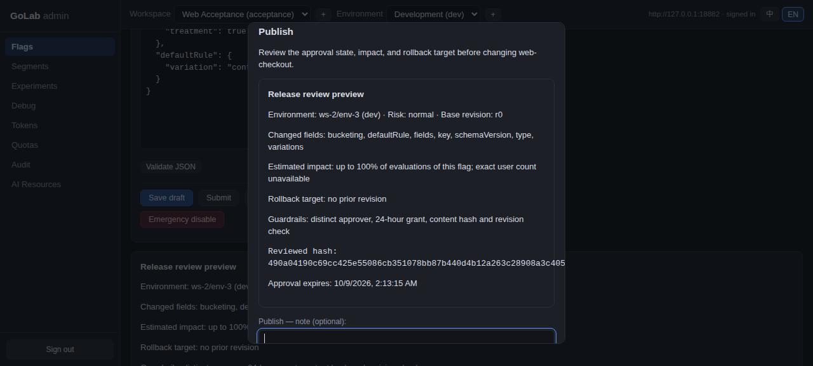
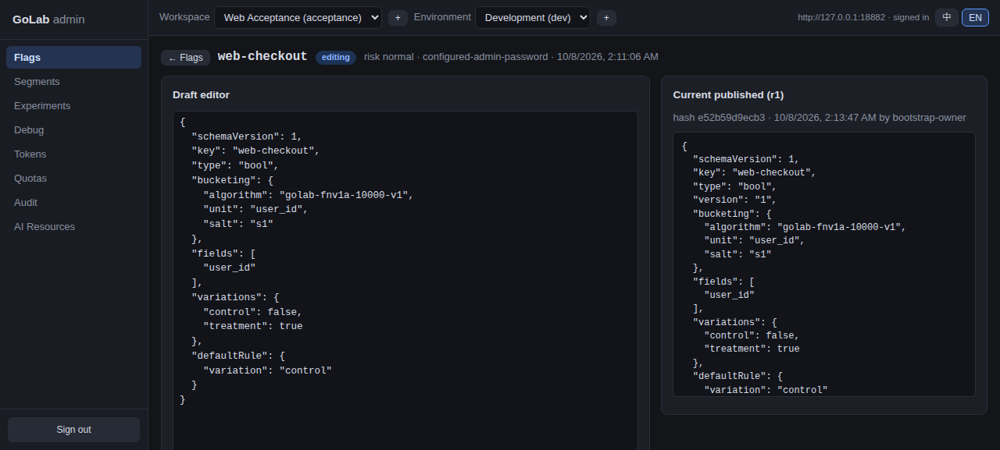
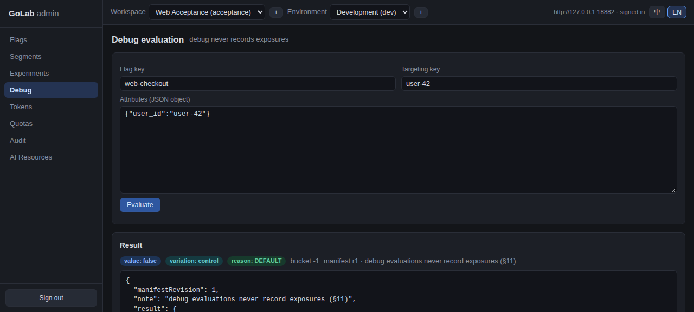
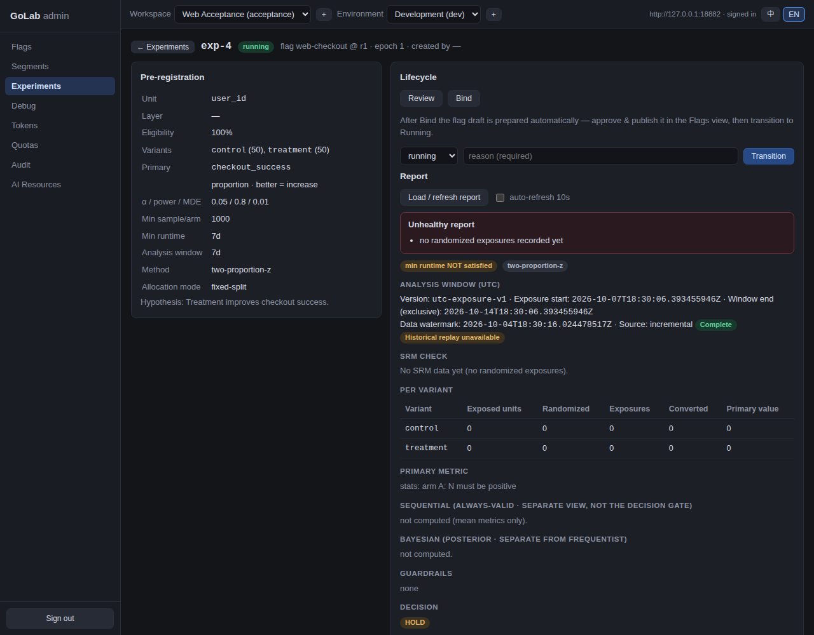
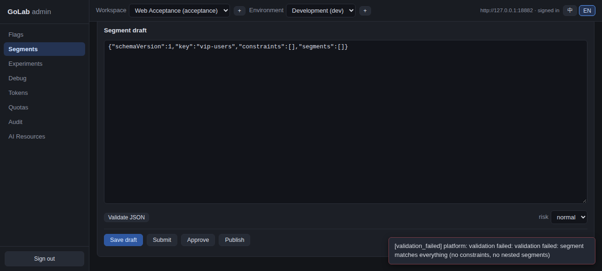
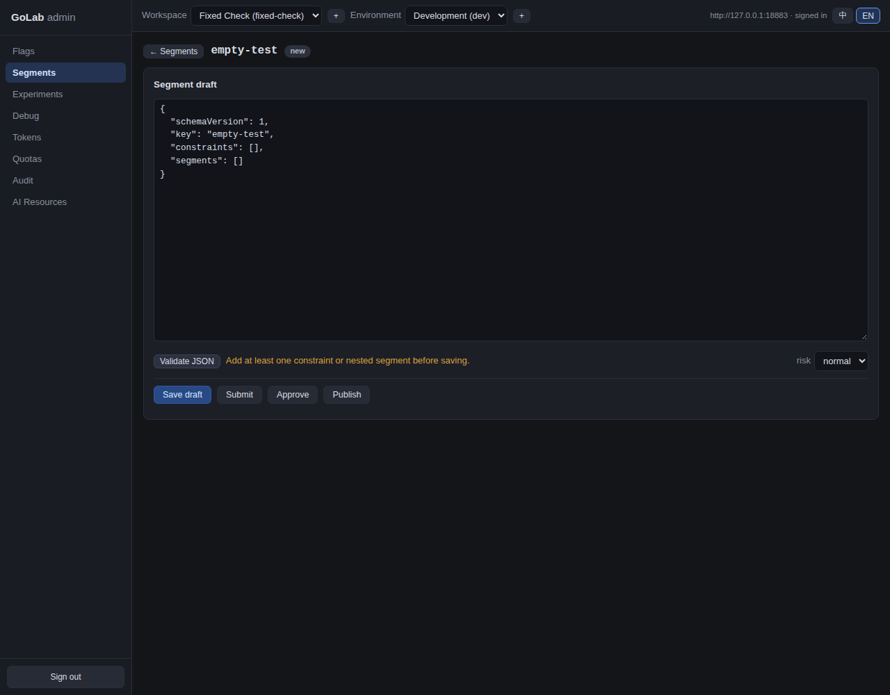
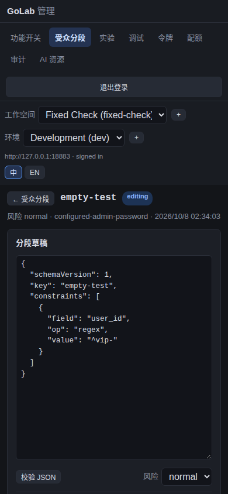

# GoLab Web 管理台真实浏览器验收报告

验收日期：2026-10-08（Asia/Shanghai）

代码基线：`9e77bc8` 加当时的本地修改

结论：**主要管理闭环已在真实浏览器和真实 Go 服务上走通；尚不能宣称所有功能完成验收。**

## 1. 范围和方法

- 使用 Chromium，由 `agent-browser` 操作真实页面，查看 DOM、截图和浏览器网络请求；未使用接口模拟或页面假数据。
- 启动两个本机隔离的 GoLab 实例：`127.0.0.1:18882` 用于完整业务流程，`127.0.0.1:18883` 用于修复后的分群回归。均采用内存管理数据、随机本机密码，不连接生产工作区。测试完成后两个进程和浏览器均已关闭。
- 合成工作区 `acceptance` / 环境 `dev`、开关 `web-checkout`、分群 `vip-users`、实验 `exp-4`。通过两种独立管理员身份执行需要不同提交人与批准人的流程。
- 截图只显示测试数据；没有截取一次性令牌明文。浏览器网络记录用于确认服务器实际响应，截图用于确认页面反馈。
- 此报告覆盖 Web 可见的主要模块与关键管理闭环；生产集群、真实 SDK 流量、长时间调度、统计显著性和所有边界组合仍需另行验收。

## 2. 验收结果

| 模块 / 场景 | 浏览器操作与实际结果 | 判定 | 截图 |
| --- | --- | --- | --- |
| 登录与会话 | 密码登录成功；刷新后仍登录；退出后刷新回到登录页。`document.cookie` 为空、旧版 `golab_token` 本地存储为 `null`。 | 通过 | [登录](01-login.png)、[工作区](04-workspace-environment.png) |
| 工作区与环境 | 从空实例创建工作区、环境；创建请求均返回 `201`，切换器显示新对象。 | 通过 | [创建](03-create-workspace.png)、[结果](04-workspace-environment.png) |
| 开关草稿与发布 | 新建 `web-checkout`；保存 `200`、提交 `200`。提交者自批返回 `403`；另一管理员批准 `200`、发布 `200`，出现已发布 r1。 | 通过 | [发布前复核](07-publish-review.png)、[已发布](08-flag-published.png) |
| 调试求值 | 输入用户键和 `user_id`，求值接口返回 `200`；页面显示 `false`、`control`、`DEFAULT` 与 manifest r1。 | 通过 | [调试结果](10-debug-result.png) |
| 分群编辑与离开保护 | 未保存修改时切换导航出现确认；取消后保留输入。 | 通过 | [未保存编辑](12-unsaved-segment.png) |
| 分群草稿与发布 | 有效 `user_id` 正则分群保存 `200`、提交 `200`、跨身份批准 `200`、发布 `200`；审计页有 `segment.publish` 记录。 | 通过 | [发布复核](14-segment-review.png)、[审计记录](19-audit-filter.png) |
| 分群空规则校验 | 原页面把服务端拒绝的空规则模板当作 JSON 有效，保存返回 `400`。已修复：新实例页面提示必须有条件或嵌套分群，点击保存不发请求；添加有效条件后保存返回 `200`。 | **发现并修复，回归通过** | [修复后提示](24-segment-validation-fixed.png) |
| 实验创建与评审 | 创建 50/50 固定分流实验返回 `201`；评审返回 `200`，详情显示预注册参数。 | 通过 | [创建表单](16-experiment-create.png) |
| 实验绑定与运行 | 起初因已发布开关缺少匹配的 50/50 分流规则，绑定返回 `400`。经 Web 补齐规则、独立审批和发布后，绑定返回 `200`，自动草稿再经独立审批发布；切到 Running 返回 `200`。 | 通过，须满足前置条件 | [绑定后](21-experiment-bound.png)、[运行报告](22-experiment-report.png) |
| 实验报告 | 报告读取返回 `200`；无真实曝光数据时页面明确显示不健康、样本为零和 `HOLD`，未伪造实验结论。 | 通过空数据状态 | [报告](22-experiment-report.png) |
| 分阶段发布计划 | Web 提交审批请求 `201`；另一管理员批准 `200`，执行后创建计划 `201`；详情显示 `canary-10` 与动作历史。 | 通过创建闭环 | [计划](23-rollout-plan.png) |
| 令牌 | 创建环境级 SDK 令牌后列表显示 active；撤销后显示 revoked，撤销请求成功。截图未包含明文令牌。 | 通过 | [撤销结果](17-token-revoked.png) |
| 配额 | 将最大开关数 500 改为 501，保存请求 `200`，页面显示保存成功及新值。 | 通过 | [配额](18-quotas-saved.png) |
| 审计与搜索 | 审计接口返回真实操作记录；搜索 `segment` 后仅显示相关记录。紧急复核和发布计划审批在收件箱显示并可操作。 | 通过；分页下一页未触发 | [筛选结果](19-audit-filter.png) |
| AI 资源与模型白名单 | 注册资源 `201`；撤销 `200`；未复核时恢复返回 `409`；另一管理员复核 `200` 后恢复 `200`。白名单保存 `200`。 | 通过该闭环 | [资源与白名单（恢复前截图）](20-ai-allowlist.png) |
| 手机视口与语言 | 在 390×844 视口页面无横向溢出；中英文切换后导航、表单标题变化；刷新保留语言。 | 通过所测页面 | [英文手机](25-mobile-segment.png)、[中文手机](26-mobile-zh.png) |

## 3. 本次发现的缺陷及处理

**空分群模板的前端校验与服务端规则不一致。**旧页面只检查 JSON 语法和 key，用户会看到有效提示，但服务端拒绝“没有条件、没有嵌套分群”的内容，真实请求返回 `400 validation_failed`。现已在 [web/app.js](../../../web/app.js) 检查至少一条条件或嵌套分群，并在 [web/i18n.js](../../../web/i18n.js) 增加中英文提示。修复版浏览器实测：空规则验证显示警告、保存不发请求；有效规则验证成功并保存 `200`。详见[旧错误截图](13-segment-draft.png)与[修复后截图](24-segment-validation-fixed.png)。

**实验绑定的前置条件不直观。**绑定只接受已发布且具备匹配比例百分比规则的开关。首次使用仅有默认规则的开关返回 `400`；补齐 50/50 规则并发布后返回 `200`。这是正确的后端约束，但 Web 可以在点击绑定前展示比例匹配检查和修复指引。本轮未修改该引导。

**发布计划调度未被此次模拟验收覆盖。**隔离实例关闭了定时 rollout/reconcile 循环，因此只验证了审批、创建和历史显示。截图中的“等待进入 running”状态与此测试配置有关，不代表生产调度结果。

## 4. 尚未完成的验收

| 功能 | 原因 / 下一步 |
| --- | --- |
| 开关回滚、紧急停用、删除草稿、GFF 导入 | 本轮没有执行这些有状态分支；需要在隔离实例按各自审批与恢复路径逐项实测。 |
| AI 版本固定、内容解析 | 本轮验证了注册、撤销、复核、恢复及白名单；尚缺内容版本和解析闭环。 |
| 审计分页 | 搜索和记录读取已验证，样本不足 25 条，未产生可点击的下一页。 |
| 分阶段发布自动推进、暂停、接管 | 定时引擎关闭，未等待运行时间和观察窗口；须用可控时钟或短窗口的测试环境验证。 |
| 实验真实曝光、事件采集、统计判定 | 未投送 SDK 流量；报告只能验证零样本状态与计算入口。 |
| 其他实验类型与指标 | 本轮只创建固定分流、双变体、比例主指标；未覆盖 bandit、ratio、quantile、funnel、retention 等组合。 |
| 生产部署与跨节点行为 | 本报告仅基于本机隔离服务，不能替代 K8s 环境验收。 |

## 5. 代码与自动检查

- `node --check web/app.js`：通过。
- `node web/i18n_contract.mjs`：通过，覆盖中英文目录、页面及切换契约。
- `node web/capability_contract.mjs`：通过，覆盖角色、工作区与审批状态契约。
- 本轮浏览器 `errors` 输出为空；出现的 `400`、`403`、`409` 均已在上文解释，并在满足前置条件后重试成功。
- 本次验收使用本地未提交工作树；先前针对 Go API、存储和 Web 的定向测试已通过。此处不把它表述为全仓测试或生产验证。

## 6. 截图索引

上表已连接关键截图。其余过程截图保存在[同一目录](./)，编号 `01` 至 `26`，均来自实际浏览器。截图 `13` 保留了发现缺陷时的原始 400 反馈；截图 `24` 为修复后的相同场景。测试实例和浏览器已关闭，截图与报告保留在仓库工作树中。

### 关键画面

**开关发布复核与已发布版本**

**调试求值与实验零样本报告**

**发现并修复的分群校验问题**

**审批执行后的发布计划与手机视口**

