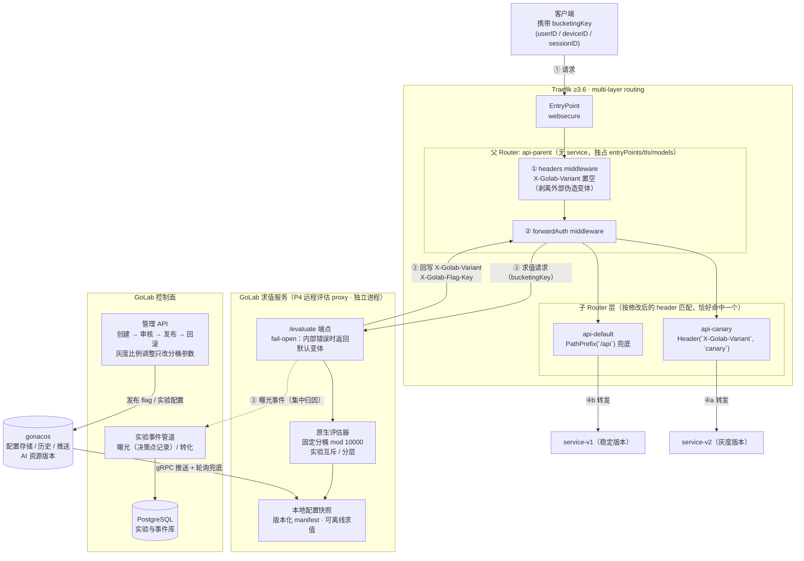

# GoLab × Traefik 3.6 流量灰度架构（multi-layer routing）

> 依据 Traefik 官方 multi-layer routing 文档与 PR #12130（milestone 3.6）设计。
> 该方案替代早期"local plugin 内嵌 SDK 写 header"的不成立路线；ForwardAuth 为标准 middleware，无 Yaegi 兼容性问题。
>
> **状态：已端到端验证**——真实官方 Traefik **v3.7.13** 二进制（SHA-256 校验）跑通本图全链路，七项验收断言（稳定路由/分布/比例调整零网关配置变更/伪造剥离/fail-open 非 5xx/KV provider 实证/方法透传）全部通过：`test/gateway`，数值见 [实施状态](实施状态.md)"网关集成验证证据"节。落地组件：求值服务 fail-open 端点 = `cmd/golab-proxy` 的 `GET /api/v1/gateway/forwardauth`（`-gateway-token`）；router 配置生成器 + 层级校验 = `internal/gateway`（file/KV/IngressRoute 三目标）。与本图的唯一实现差异：KV 目标的 ① header 剥离改由 forwardAuth 的 `authResponseHeadersRegex: ^X-Golab-` 承担（实测 Traefik KV 解码器丢弃空值，headers middleware 置空语义在 KV 不可表达）；file/IngressRoute 仍生成图示的显式 headers middleware，两机制语义等价且都经真实链路验证。

## 请求链路总览



## 关键设计性质

| 性质 | 说明 |
|---|---|
| 比例调整零配置传播 | 5% → 20% 只改 GoLab 侧分桶参数，Traefik 动态配置不动，无 provider 传播延迟 |
| 与 SDK 同算法 | 求值服务与应用内 Go SDK 使用同一原生评估器和黄金向量，同一 bucketingKey 两层结果一致 |
| 曝光集中记录 | ForwardAuth 决策点产生曝光事件，直接写入 P2 实验事件管道，归因不依赖后端各自上报 |
| 复用 P4 组件 | 求值服务即技术方案 P4 的远程评估 proxy，Traefik 集成（P5）只是新增一个消费方 |

## 按 client IP 灰度

求值服务（golab-proxy）可从**可信代理链**推导客户端真实 IP，以保留属性名 `client_ip` 注入求值上下文，支撑"按 IP 段灰度"（内网先行、地域放量等）。链路（文字版）：

```
客户端
  │  X-Forwarded-For: <客户端可伪造的前缀…>
  ▼
① 边界 XFF 消毒 —— Traefik entryPoint 配置 forwardedHeaders.trustedIPs
  │  （只保留边界自己记录的真实对端；外部伪造段在此被丢弃）
  │  X-Forwarded-For: <边界记录的真实客户端 IP>
  ▼
② 求值注入 client_ip —— golab-proxy `-trusted-proxy-cidrs <边界/网关网段>`
  │  forwardAuth 求值与 /sdk/eval 中继两条服务端求值路径均生效：
  │  从连接 RemoteAddr 出发，仅当当前 IP 落在可信 CIDR 内才继续向左消费
  │  XFF；第一个不受信 IP 即 client_ip，其左侧一切条目丢弃。
  │  未配置 ⇒ 不信任任何 XFF，client_ip = 直连对端（现网行为不变）。
  │  信任链中出现非法条目 ⇒ fail closed：不注入（缺字段不命中任何约束，
  │  走 flag 默认规则）。
  ▼
③ in_cidr 定向或 IP 分桶 —— flag 在 fields 注册 client_ip：
  │  constraints: [{field: client_ip, op: in_cidr, value: 10.0.0.0/8}] → candidate
  │  或 bucketing.unit: client_ip（按 IP 百分比分桶）
  ▼
④ 子 router 分流 —— 回写 X-Golab-Variant，子 router 按 Header(...) 命中后端
```

安全语义（防"客户端自报 IP 自选灰度组"）：

- **不受信段一律丢弃**：客户端只能影响 XFF 中位于"最后一跳可信代理所记录的真实对端"**左侧**的条目，而推导在第一个不受信 IP 处即停止——伪造前缀不改变结果（e2e 实证：外网来源携带 `XFF: 10.9.9.9, <真实外网 IP>` 仍命中 control）。
- `-trusted-proxy-cidrs` **绝不可**包含客户端可直接连入的网段（如 `0.0.0.0/0`）：信任某网段=相信它"追加"的 XFF 条目，该网段内任何来源都能自选灰度组。
- 网关注入优先于 header：forwardAuth 路径的 `client_ip` 恒为 proxy 派生值（请求 header 永不喂给它）；`unitField=client_ip` 时分桶单元也取派生 IP，`X-Bucketing-Key` 被忽略。`/sdk/eval` 中继路径上，**调用方显式传入的 `attributes.client_ip` 优先**（持 SDK 凭证的服务端调用方可能自己坐在已消毒的边界后面），派生值仅在缺省时注入。
- 端到端验收：`test/gateway/clientip_e2e_test.go`（真实 golab + 两个真实 proxy 进程：内网段命中 candidate、外网段命中 control、单级/多级伪造 XFF 均无效、未配置信任链时 XFF 被忽略、中继注入与显式值优先）。

**实验慎用**：`client_ip` 作为 bucketing unit 仅建议用于无身份要求的流量路由/容量灰度。IP 随 NAT、DHCP、代理链变化漂移——同一用户跨请求换 IP 即换臂，破坏粘性与曝光归因（§6"随机化单元必须是经过认证或可信生成的稳定 ID"）；实验级分桶应使用认证稳定 ID。校验**不阻断** `unit: client_ip`，警示以文档为准。

**隐私提示**：`client_ip` 是个人数据（GDPR/PIPL 语境下的在线标识符）。它只进入求值上下文用于规则匹配：曝光事件仅存储单元的 HMAC 伪名（§10.2），不落原始 IP；但求值上游的访问日志、代理日志可能记录 XFF——部署时按当地合规要求评估日志保留期与脱敏，内网灰度优先考虑用私有网段边界而非记录精确 IP。

### 端到端示例

```yamlc
# ① Traefik 静态配置：边界消毒——只信任 LB 网段，把 XFF 重写为真实客户端
entryPoints:
  websecure:
    address: ":443"
    forwardedHeaders:
      trustedIPs: ["172.16.0.0/12"]   # 前置 LB 的网段
```

```bash
# ② golab-proxy：声明可信的一跳（Traefik 所在网段）
./bin/golab-proxy -addr 127.0.0.1:8689 -upstream http://golab:8688 \
  -gateway-token glab_sdk_... -gateway-secret <RouteSpec.Secret> \
  -trusted-proxy-cidrs 172.16.0.0/12   # 亦可用 env GOLAB_TRUSTED_PROXY_CIDRS
```

```yaml
# ③ GoLab flag：注册 client_ip 字段，in_cidr 定向——内网段先行灰度
schemaVersion: 1
key: checkout-router
type: string
fields: [user_id, client_ip]
variations:
  control: stable-value
  candidate: canary-value
defaultRule: {variation: control}
targeting:
  - name: internal-net          # 内网来源 → 灰度版本
    constraints: [{field: client_ip, op: in_cidr, value: 10.0.0.0/8}]
    variation: candidate
```

```
# ④ 生效链路：外网客户端伪造内网 XFF 也无法进入灰度组
GET / HTTP/1.1                        # 客户端（203.0.113.9）携带伪造头
X-Forwarded-For: 10.9.9.9             # ← 伪造，在 ①/② 两级信任边界被丢弃
X-Bucketing-Key: user-42

Traefik 消毒后 XFF: 203.0.113.9       # ① 边界记录真实对端
golab-proxy 派生 client_ip=203.0.113.9 # ② 可信一跳回退后停在第一个不受信 IP
求值: in_cidr 10.0.0.0/8 不命中 → control
子 router: Header(X-Golab-Variant, control) → 稳定版后端   # ④
```

## 约束与必须处理的风险

1. **Provider 限制**：multi-layer routing 仅支持 file、KV（Consul/etcd/Redis/ZooKeeper）、Kubernetes CRD（IngressRoute）；Docker label、K8s Ingress、Gateway API 不支持。GoLab 管理面需将实验 router 配置生成到受支持的目标（已实现：`internal/gateway`，file 与 KV 经真实 Traefik 验证，IngressRoute 已在固定版本 kind 集群完成真实请求验收（见 [IngressRoute 集群验证](IngressRoute集群验证.md)））。**KV 附加限制（实测）**：Traefik KV 解码器丢弃空值键，headers middleware 的置空剥离在 KV 不可表达——KV 目标必须用 forwardAuth `authResponseHeadersRegex` 完成剥离。
2. **层级规则**：根 router 独占 `entryPoints`/`tls`/models；中间 router 不得定义 service；叶子 router 必须有 service。控制面生成配置时须按此校验。
3. **求值服务可用性**：ForwardAuth 失败默认拒绝请求。求值服务须高可用部署，且内部错误 fail-open 返回默认变体，避免网关 5xx；对应 P5 验收的"紧急撤销安全降级"。
4. **安全边界**：外部请求自带的 `X-Golab-Variant` 必须在父 router middleware 链最前剥离；变体 header 只接受求值服务经 `authResponseHeaders` 回写的值。求值端点自持 SDK 凭证，因此校验 forwardAuth address 内嵌的**共享路由 secret**（生成器 `RouteSpec.Secret` ↔ proxy `-gateway-secret`，常数时间比较）：无 secret 的直连探测不触发上游求值（`unauthorized` fail-open），端点不构成任意 flag 探测/曝光污染 oracle。

## 参考

- Traefik multi-layer routing 文档：`docs/content/reference/routing-configuration/http/routing/multi-layer-routing.md`（traefik/traefik master）
- PR #12130（merged 2025-10-22，milestone 3.6）：<https://github.com/traefik/traefik/pull/12130>
