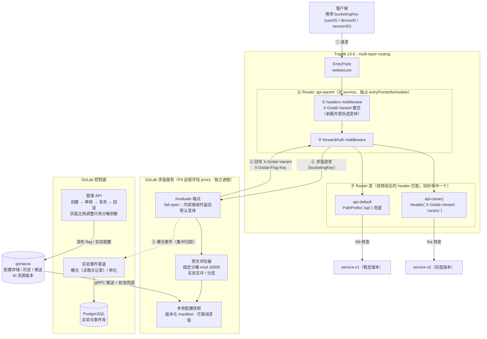

# GoLab × Traefik 3.6 流量灰度架构（multi-layer routing）

> 依据 Traefik 官方 multi-layer routing 文档与 PR #12130（milestone 3.6）设计。
> 该方案替代早期"local plugin 内嵌 SDK 写 header"的不成立路线；ForwardAuth 为标准 middleware，无 Yaegi 兼容性问题。

## 请求链路总览

## 关键设计性质

| 性质 | 说明 |
|---|---|
| 比例调整零配置传播 | 5% → 20% 只改 GoLab 侧分桶参数，Traefik 动态配置不动，无 provider 传播延迟 |
| 与 SDK 同算法 | 求值服务与应用内 Go SDK 使用同一原生评估器和黄金向量，同一 bucketingKey 两层结果一致 |
| 曝光集中记录 | ForwardAuth 决策点产生曝光事件，直接写入 P2 实验事件管道，归因不依赖后端各自上报 |
| 复用 P4 组件 | 求值服务即技术方案 P4 的远程评估 proxy，Traefik 集成（P5）只是新增一个消费方 |

## 约束与必须处理的风险

1. **Provider 限制**：multi-layer routing 仅支持 file、KV（Consul/etcd/Redis/ZooKeeper）、Kubernetes CRD（IngressRoute）；Docker label、K8s Ingress、Gateway API 不支持。GoLab 管理面需将实验 router 配置生成到受支持的目标。
2. **层级规则**：根 router 独占 `entryPoints`/`tls`/models；中间 router 不得定义 service；叶子 router 必须有 service。控制面生成配置时须按此校验。
3. **求值服务可用性**：ForwardAuth 失败默认拒绝请求。求值服务须高可用部署，且内部错误 fail-open 返回默认变体，避免网关 5xx；对应 P5 验收的"紧急撤销安全降级"。
4. **安全边界**：外部请求自带的 `X-Golab-Variant` 必须在父 router middleware 链最前剥离；变体 header 只接受求值服务经 `authResponseHeaders` 回写的值。

## 参考

- Traefik multi-layer routing 文档：`docs/content/reference/routing-configuration/http/routing/multi-layer-routing.md`（traefik/traefik master）
- PR #12130（merged 2025-10-22，milestone 3.6）：<https://github.com/traefik/traefik/pull/12130>
