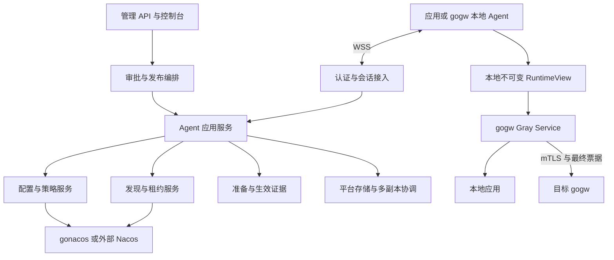

# Grayling 统一 Agent 协议：实施与验收方案

> 状态：设计提案，尚未实现或验收。日期：2026-10-16。
>
> 本方案依据 Grayling 提交 `c730003`、当前工作区接口，以及 gogw 提交 `62b1f935f7612dbb730504e8210d8cffe2f4aef7` 的代码制定；工作区可能包含未提交变化，实施前记录完整 SHA 和 diff 摘要。目标需求见 [gogw issue #1](https://github.com/godeps/gogw/issues/1)。本文的协议名、端点、消息、目录和命令中注明“拟新增”的内容均不能作为现成功能使用。

## 1. 目标、范围与设计决定

为服务端应用和网关提供一套 Grayling Agent 协议，通过一个 WSS 接入口完成配置订阅、灰度策略同步、实例注册发现、发布准备与生效确认、状态及事件回报。业务请求继续在本地求值，不逐次同步调用 Grayling。

决定如下：

1. 定义独立于传输的消息模型；首期采用 WebSocket 二进制消息承载 Protobuf，子协议 `grayling.agent.v1`，拟新增入口 `GET /api/v1/agent/connect`。
2. Grayling 接入层直接调用应用服务和底座适配器。内置 gonacos 使用进程内服务调用；外部 Nacos 使用专用适配器。首期不增加“WebSocket → gRPC → 本机服务”的中转。
3. `.proto` 用于契约和多语言生成，并不要求使用 gRPC。未来如需 gRPC 双向流入口，应复用授权、命令处理和状态模型，不另建发布逻辑。参见 [Protobuf 概述](https://protobuf.dev/overview/)与 [gRPC 双向流模型](https://grpc.io/docs/what-is-grpc/core-concepts/)。
4. 统一通道承载控制与同步，不代理业务 HTTP/SSE 流。大资源走受授权 HTTPS 下载，通道传不可变引用、摘要、大小和有效期。
5. 兼容现有 HTTP/SSE SDK、OpenFeature、管理 API 与原生 Nacos 客户端；Agent 通道首期可选启用。
6. 首期 Go Agent 可用；Python/TypeScript 的 Agent 模式后续按同一协议实现。浏览器管理端不复用实例注册凭证。

首期包括 HTTP/HTTPS 与 SSE 网关集成所需控制能力。不承诺应用连接迁移、跨副本 exactly-once、通用远程任务执行、任意文件系统配置写入或所有 Nacos 协议透明代理。

## 2. 现有能力与需要新增的能力

| 领域 | 当前代码依据 | 本次新增或补齐 |
| --- | --- | --- |
| 配置发布与快照 | `internal/configstore` 不可变文档、manifest、读回及摘要校验 | Agent 订阅、资源引用、统一 revision 语义 |
| 本地求值 | `pkg/evaluation`、`pkg/model`、`pkg/bucketing` | 固定快照 evaluator 与完整运行视图组合 |
| SDK 同步 | `pkg/sdk/client.go`：HTTP 全量拉取、ETag、SSE、轮询、陈旧限制 | 传输适配、会话恢复、应用回执 |
| 注册发现 | 固定 gonacos 依赖含 Naming；`app.go` 当前主要取 Config/AI | 注册发现适配、租约、权限、归一化成员视图 |
| 外部 Nacos | `internal/nacos/client.go` 当前主要封装配置 Admin API | 独立 Naming 适配，真实版本兼容测试 |
| 审批与灰度发布 | 现有管理、发布、rollout 能力 | 独立的网关部署状态与实例准备/生效证据 |
| 网关接入 | [已有 Traefik 多层路由方案](traefik-grayling-architecture.md) | gogw Gray Service、可信一次转发及 RuntimeView |
| 信任与持久化 | 现有作用域认证、平台存储、摘要机制 | Agent 权限、快照签名、防倒退高水位及 fencing |

已有 ForwardAuth 路线保留其独立验收结论。本方案的共部署路线要求本地决策与一次可信跨版本转发，不能用已有远程求值测试替代。

## 3. 组件与请求边界



- Grayling 管理策略、权限、发布意图、实例目录和执行证据。
- Agent 管理连接、同步、资源验证、运行视图构造与本地生命周期；嵌入和独立进程模式共用客户端实现。
- gogw 执行身份验证、build 决策、实例选择、票据签发校验、业务代理与排空。
- supervisor 负责应用、网关、Agent 的信号传递和成对退出；Grayling 无法替代容器进程管理。
- 注册中心提供候选成员；部署证书和目标实际校验提供授权证据。注册地址标签本身不可信。

## 4. 协议模型与连接生命周期

### 4.1 消息信封

拟新增 `Envelope` 使用显式 `oneof`，禁止任意方法名反射调用：

| 字段 | 含义 |
| --- | --- |
| `protocol_major/minor` | 不兼容主版本与可协商次版本 |
| `session_id`、`connection_epoch` | 服务端签发的会话及连接 fencing 代次 |
| `message_id`、`reply_to` | 消息关联；不充当跨连接幂等键 |
| `operation_id` | 可变更操作的幂等键，跨重试保持不变 |
| `subscription_id`、`resource_kind/key` | 订阅及资源定位，必须受服务端授权 |
| `stream_seq` | 单会话订阅事件序号；重连后不可代替资源版本 |
| `resource_revision` | 对应资源的权威版本 |
| `deadline_unix_ms` | 命令期限，由服务端限制最大预算 |
| `payload` | 明确类型的消息体 |

Protobuf 中 revision/generation 使用 64 位整数，跨语言 JSON 调试输出使用十进制字符串，避免 JavaScript 精度丢失。时间统一 UTC 毫秒；租约期限以服务端时钟为准。

主版本不兼容直接拒绝；未知可选字段允许忽略，未知必需能力拒绝握手。未知消息类型返回 `UNSUPPORTED_MESSAGE`，不得静默执行。签名内容使用单独定义的规范编码或保存的原始载荷字节，不能假定 Protobuf 的默认序列化天然规范化。

### 4.2 会话状态

```text
DISCONNECTED → CONNECTING → AUTHENTICATING → SYNCING → ACTIVE
       ↑              失败或断线 ←────────────────────┘
ACTIVE → DRAINING → CLOSED
```

握手步骤：

1. TLS 校验后，以 HTTP Authorization 携带专用 Agent 凭证；禁止 query token。凭证不得进入 URL、访问日志或消息回显。
2. 客户端发送 `Hello`：版本范围、能力、agentId、instanceId、bootId、已保存的资源版本和恢复游标。
3. 服务端验证凭证绑定的 workspace/environment/service、允许的实例身份及能力，返回 `Welcome`、服务端时间、限额、会话与 fencing 代次。
4. 对每个订阅返回可恢复增量或 `ResyncRequired`；客户端完成必要全量同步后才进入 ACTIVE。连接 ACTIVE 不等于应用 READY。
5. 心跳确认链路；续租必须携带合法实例身份及 fencing 信息。二者可以同帧批量发送，但分别返回结果。

同一 boot 重连使用更高连接代次，旧连接后续变更全部拒绝。不同 boot 对同一 instance 的接管必须通过部署授权及服务端 CAS；仅凭一个新 bootId 不能抢占其他实例。

### 4.3 消息目录

| 域 | 客户端请求/回报 | 服务端响应/推送 |
| --- | --- | --- |
| 会话 | Hello、Heartbeat、Goodbye | Welcome、HeartbeatAck、GoAway、Error |
| 订阅 | Subscribe、Unsubscribe、Resume | Snapshot、Delta、Invalidated、ResyncRequired |
| 注册 | Register、RenewLease、UpdateInstance、Deregister | Registered、LeaseRenewed、InstanceChanged |
| 配置 | FetchResource、ResourceApplied、ResourceRejected | ResourceRef、ConfigInvalidated |
| 发布 | Prepared、Applied、Rejected、ReleaseStatusQuery | Prepare、Activate、Abort、Revoke、ReleaseStatus |
| 生命周期 | ReadinessReport、DrainReport | DrainRequested、DrainStatus |
| 事件 | EventBatch | EventBatchAck |

标准错误至少包括 `UNAUTHENTICATED`、`PERMISSION_DENIED`、`CONFLICT`、`STALE_REVISION`、`FENCED`、`RESYNC_REQUIRED`、`RESOURCE_EXPIRED`、`NOT_READY`、`BACKEND_UNAVAILABLE`、`RATE_LIMITED`、`UNSUPPORTED_MESSAGE`。包含是否可重试及退避建议，不泄漏其他租户资源是否存在。

### 4.4 交付与幂等语义

- WSS 活连接内有序传输；跨断线的应用命令按至少一次处理，不承诺 exactly-once。
- 注册、准备、激活等变更以 `(scope, principal, operationId)` 去重；同 ID 不同载荷返回冲突。去重记录与实际变更同一事务提交，或通过可恢复 outbox/reconcile 达到一致。
- 请求超时不表示未执行。重连后用同 operationId 查询/重试，不生成新 ID 盲发。
- 普通 ACK 只表示接收/持久化；`Prepared` 与 `Applied` 表示资源准备和实际生效，单独建模。
- 订阅丢事件、发现版本跳跃、保留窗口过期均重新全量，不依靠永久消息日志。
- telemetry 使用 eventId 去重和有界保留；累计去重窗口外的语义必须在分析端明确，不把 ACK 描述为永久不丢失。

## 5. 注册发现与租约

### 5.1 归一化实例模型

```text
Instance = {
  workspaceId, environmentId, serviceKey,
  instanceId, bootId, buildId, imageDigest,
  address, port, tlsServerName, zone, protocolVersion,
  ready, draining, leaseId, leaseEpoch, expiresAt
}
PreparedInstance = {
  instanceId, bootId, bundleHash, appliedGeneration,
  acceptedProtocolVersion, preparedAt, expiresAt
}
```

广告地址来自平台显式配置；回环地址、入口 VIP 不能推导为跨实例地址。验证端口、地址、SNI 和允许的网段；禁止通过注册触发任意地址探测或 SSRF。实例注册只允许声明凭证授权的服务与身份。

可选集合为：有效租约 ∩ 健康就绪 ∩ 未排空 ∩ 协议兼容 ∩ build/boot 匹配 ∩ 接受目标 Bundle 的准备成员。先固定 build，再在集合内负载均衡。无可选成员返回明确不可用，不自动换 build。

### 5.2 Naming 适配与权威边界

新增发现应用服务及 Naming backend 接口；内置 gonacos 与外部 Nacos 共用上层模型。底座接入前必须验证固定版本的注册、注销、续租/连接归属、订阅、全量查询、元数据和认证能力，不把两种底座视为天然等价。

- Grayling 的 Agent 注册记录、leaseEpoch 与 Prepared 证据是协议治理状态；Naming 是成员目录，不单独决定发布可选性。
- 原生 Nacos 注册的成员可作为“未准备”候选展示，不得直接获得网关 Bundle 授权。
- 跨存储变更采用先记注册意图、幂等写 Naming、读回确认后发布的 reconcile 流程；失败期间成员不可选。注销及租约失效先从可选视图移除，再补偿底座。
- 如果底座支持的租约语义与 Agent 租约不同，Grayling 必须维护有 fencing 的租约并归一化，不能仅转发底座“健康”字段。
- 底座 revision 不满足跨节点全序时，由 Grayling 的权威发现日志/CAS 产生 scope revision。单机内存计数不可用于多副本生产。
- 订阅恢复先建立一致性屏障，取得 revision R 的全量，再发送 R 之后变更；无法保证无缝拼接时发送新的完整快照。

### 5.3 失联行为

链路断开不立即删实例；只允许授权持有者在 TTL 内续租。TTL 到期先停止新选路，已有业务流按排空策略处理。跨副本续租必须对 leaseEpoch CAS，旧会话不能延长新租约。

Agent 保存发现有效截止时间，断联最多使用至截止时间；冷启动无有效发现/策略时不就绪。可观测性分别报告连接状态、租约状态、发现年龄和应用健康。

## 6. 配置、灰度求值与完整运行视图

### 6.1 配置同步与可信恢复

复用现有不可变文档、manifest 和 evaluator；推送先以失效通知或资源引用为主。客户端下载后做大小限制、摘要、签名、scope、schema、版本和资源依赖校验；全量通过才替换。

新增签名策略包：至少绑定 scope、policyRevision、bundleHash、签发/到期时间、keyId 和载荷摘要。冻结签名算法及编码、信任根引导、密钥轮换重叠窗口、撤销与离线冷启动规则。签名密钥留在控制面；Agent 只持验证公钥。旧公钥退役不得意外使允许的在途会话中断。

高水位和可信缓存原子持久化；损坏或来源不可信的缓存不得令 Agent 就绪。恢复备份后若 revision 倒退，必须通过独立恢复授权和新的控制面 epoch 处理，不能清空高水位绕过防倒退。续新鲜度与延长包授权期限分别定义，普通心跳不延长策略签名有效期。

### 6.2 本地 RuntimeView

```text
RuntimeView = {
  policyRevision, releaseGeneration, bundleHash,
  compiledEvaluator, discoveryRevision, eligibleEndpointsByBuild,
  preparedRevision, handlersAndTransports,
  policyExpiry, discoveryExpiry, revocationEpoch
}
```

候选视图必须先完整构造，再原子切换。请求只捕获一次视图引用，不混读独立更新的 SDK 与服务列表。旧视图及连接池在在途引用释放后回收；紧急撤销通过单独的实时拒绝/取消机制覆盖旧视图。

配置 revision、发布 generation、发现 revision 独立推进。发现变化可重建同策略的新视图；旧策略不能覆盖新策略。文件 Provider 可作为启动/POC 入口，但文件写成功不等于处理链生效。独立进程 Agent 通过受限 loopback/UDS 交付视图，gogw 返回实际生效摘要；不能只检查文件 mtime。

### 6.3 分桶、身份与曝光

- 复用 `grayling-fnv1a-10000-v1` 与已有黄金向量；服务键映射到固定 flag/experiment，workspace/environment 使用不可变内部 ID。
- 固定随机单元、salt、epoch、purpose 和编码。扩缩容、实例地址、bootId 不进入分桶输入。
- 单调放量使用固定坐标资格阈值，再独立分配实验组；普通多变体权重调整不承诺跨比例稳定。变更随机坐标必须新 epoch 并说明迁移影响。
- 白名单、属性、CIDR 的优先级用表格和测试固定。认证由应用/网关完成；客户端自报的身份 Header 或 IP 属性不得直接当作可信输入。
- 缺身份、陈旧、签名失效和资源不兼容分别返回明确结果；网关显式配置拒绝或允许的默认 build，不能把 SDK 默认值自动解释为成功决策。
- 实验配置使用显式曝光模式；实际执行/渲染确认后上报。分配、网关转发成功和业务曝光是不同事件。
- 会话绑定 build、Bundle、资源版本，重连验证签名绑定。旧资源保留至引用归零或明确排空上界。

## 7. 发布编排与 gogw 集成

### 7.1 发布对象与状态机

Bundle 固定策略、build 映射、应用资源摘要、协议最低版本和有效期；可选实例目录不纳入不可变 Bundle，实例准备证据绑定 Bundle。releaseGeneration 由服务端按 scope 单调分配，重试不分配新代次；回滚也是更高代次。

```text
DRAFT → VALIDATED → PREPARING → PREPARED → ACTIVATING → VERIFYING → ACTIVE
                        ↘ FAILED / ABORTED
ACTIVE → ROLLBACK_PREPARING → ROLLBACK_VERIFYING → ROLLED_BACK
```

1. 审批后的发布生成 Bundle，验证目标 build、资源兼容、默认策略和回滚资源。
2. 向目标实例发送 Prepare；实例下载校验资源、检查本地 build/boot 与应用健康，返回 Prepared。
3. 检查每 build/AZ 最低容量、证据 TTL 和最大准备失败率；在原子决策点重新校验，过期证据不可计数。
4. 向源端发送 Activate；源端构造完整视图并切换，返回包含实际 policy/discovery/prepared revision、generation、bundleHash、bootId 的 Applied。
5. 控制面执行探测，核对实际后端 build、资源摘要及分布，达到传播窗口内的成功门槛才进入 ACTIVE。
6. 未确认、NACK 或部分成功进入显式 VERIFYING/FAILED；停止自动递增并按批准策略恢复。已激活节点不能因 Abort 静默倒退，恢复必须发布更高代次。

Prepared 证明“能接受”，Applied 证明“活动视图已切换”，探测证明“实际路径执行正确”。默认发布门槛见第 11 节，不能以控制面 API 200 替代。

### 7.2 灰度网关执行边界

gogw 增加 Gray Service，复用 Traefik 代理与版本内负载均衡。内部分支校验网关 mTLS 身份及最终票据，绑定服务/环境、目标 instance/boot、build、Bundle、generation、请求 method/authority/path/query、有效期、签名 keyId，且 `hop=1`、`final=true`。合法请求只进入本地应用。

保留标记存在或对端是网关身份时必须进入内部校验；失败拒绝，不能剥离后降级普通入口。普通入口不能自选内部版本和身份 Header。请求体流式透传，首期不启用通用重放重试；已经发送且结果未知的写请求不自动重放。目标故障最多有限重选同 build，且只限可证明尚未发送的情况。

单端口选择可选客户端证书验证策略，并在处理器内额外要求合法 peer 与票据。连接池隔离包含 bootId 与身份；地址复用不能继承旧证书/准备证据或旧池。HTTP/2、SSE、请求取消与退出必须实测，不能从底层支持 HTTP/2 推导排空已完成。

### 7.3 排空、回滚与撤销

排空顺序为撤就绪/停止可选 → 等待发现传播 → 到接收截止时间拒绝新业务流 → 完成在途流 → 到上界关闭 → 退出应用和网关。HTTP/2 要阻止新 stream，不能只停止新 TCP。Agent 保持控制连接到必要回报结束，控制通道断开不得提前杀业务流。

100% 业务选中新 build 不表示旧入口容量可退役；分别验收入站 LB 迁移和业务放量。普通回滚停止新候选暴露，旧会话依约排空；紧急 Revoke 单独说明是否取消活动流。稳定版本不可用时阻断盲目回滚并报告恢复受阻。

## 8. 安全、配额与多副本

### 8.1 授权与暴露面

- Agent 凭证单独签发，权限至少拆成 config.read、discovery.read、instance.register、instance.renew、release.report、events.write；发布激活权限留在管理控制面。
- scope 从凭证派生，消息只能进一步缩小范围。跨 scope 的 Subscribe、续租、Prepared、资源下载、恢复游标均需负例测试。
- Agent 入口不接受控制台开发者自动登录身份；机器凭证模式与现有 dev owner session 明确隔离。
- 公网只启用 WSS，限制 Host/Origin；机器客户端无 Origin 可按明确策略允许，拒绝浏览器跨站带 cookie 冒用。
- 令牌轮换采用新连接认证并 fencing 切换；令牌撤销后在规定窗口关闭连接并拒绝续租。跨节点共享撤销状态。
- 对包大小、解压后大小、消息速率、订阅数、连接数、身份数、资源下载和事件批次设限；签名验证也需预算。
- 日志不记录凭证、票据、原始用户属性、完整配置和事件体；默认不开放任意 RPC、shell 或文件读写能力。

### 8.2 背压与重连

每连接分别维护控制/租约、资源通知、遥测队列，单 writer 按优先级调度。限制每帧大小，避免一个大帧长期占用连接。遥测满时可按策略丢弃并计数；资源通知可合并为最新 invalidation；发布命令溢出必须明确失败或断开要求重同步，不能静默丢弃。

使用带随机抖动的指数重连退避，并设置 scope 级准入和服务端 RetryAfter。服务端优雅退出发送 GoAway，等待有限迁移时间；客户端在连接接管成功前不重复创建业务实例。

### 8.3 多副本状态

连接可以驻留任意 Grayling 副本；事件总线只负责唤醒，权威状态来自共享存储。复用现有 PostgreSQL 平台存储及已有协调设施时，必须验证事务与锁语义；单机 JSON/SQLite 模式明确不提供跨节点协调。

共享保存租约/fencing、资源高水位、发布状态、幂等操作、Prepared/Applied 和 outbox。Leader 变更后依赖 fencing 阻断旧发布者。副本丢失后客户端可以在其他节点恢复，不依赖 sticky session 才能正确。

发现通知漏发由定期 reconcile 和快照刷新收敛。后端不可用时停止确认未持久化变更；连接可保持，但明确返回 BACKEND_UNAVAILABLE，不能凭内存继续续租或分配全局 revision。

## 9. 实施拆分与交付物

以下目录是拟新增建议，实施时按邻近包结构调整；各阶段独立 PR，禁止一次性替换全部 SDK。

| 阶段 | 内容与拟修改位置 | 必须交付 | 阶段退出门槛 |
| --- | --- | --- | --- |
| P0 契约冻结 | `docs/`、固定代码与底座版本 | ADR、消息/错误表、权限矩阵、部署网络与底座能力 POC | 一端口 WSS、跨实例地址、内外 Naming API 能力有证据；不支持项公开 |
| P1 通道骨架 | 拟新增 `api/agent/v1`、`internal/agent`；接 `internal/api`、`app.go` | proto、生成脚本、握手/限额/fencing、Go 客户端骨架 | 鉴权、重连、旧连接拒绝、泄漏测试通过 |
| P2 配置与本地求值 | 复用 configstore/evaluation/sdk，拟新增 `pkg/agent` | 签名快照、资源下载、缓存与高水位、黄金向量 | 离线本地求值、陈旧边界、防倒退、HTTP/SSE 回归通过 |
| P3 注册发现 | 拟新增发现服务与 Naming adapters；扩展存储 | 注册租约、订阅、全量恢复、Prepared 模型 | embedded/external 矩阵、跨副本租约/fencing、失效收敛通过 |
| P4 发布闭环 | 扩展现有审批/rollout；新增独立网关发布对象 | Prepare/Activate/Applied、容量门槛、状态查询与控制台只读证据页 | 部分成功、旧消息、回滚/撤销、崩溃恢复通过 |
| P5 gogw 接入 | gogw dynamic Service、service builder、Agent 交付接口 | 双 build demo、RuntimeView、mTLS/票据、supervisor 示例 | 可信一次转发、实际后端证据、SSE/HTTP2 排空通过 |
| P6 多副本与生产验收 | 协调、持久化迁移、监控、压测与故障脚本 | 运维手册、容量报告、升级/回退演练、验收索引 | 第 10—12 节门槛全部满足或明确阻断 GA |

P0/P1 的网关静态双 build POC 可提前开展，但正式 P5 必须接完整协议。P2/P3 在契约冻结后可以独立实施，P4 依赖二者；P6 的多副本设计约束必须从 P1 开始落实，不能最后才替换内存状态。

预计工作量应在 P0/P1 后按测量重估，不用日历期限替代阶段退出条件。角色至少包括 Grayling 协议/服务负责人、底座适配负责人、gogw/生命周期负责人及验收负责人；一人可承担多个角色，但交付证据必须逐项归属。

## 10. 功能与故障验收矩阵

每项测试记录前置条件、固定版本、操作时间线、预期/实测和证据路径；“测试进程退出 0”不能替代关键断言。

| ID | 场景与故障注入 | 必须断言 |
| --- | --- | --- |
| A01 | 新旧协议、未知字段/消息、超大/损坏帧 | 兼容行为明确；不崩溃，不执行未知操作 |
| A02 | 错误 token、跨租户订阅/注册/资源读取、cookie/dev 身份 | 全部拒绝，无资源及凭证泄漏 |
| A03 | 同 boot 双连接、新 boot 接管、旧连接延迟续租 | 只有当前合法 leaseEpoch/connectionEpoch 可变更 |
| A04 | 命令执行后响应丢失，再发同 operationId | 只产生一个逻辑变更；不同载荷冲突；状态可查询 |
| A05 | 快照损坏、篡改、错误 scope/签名、缺资源 | 候选整包拒绝、旧有效视图保持；失败可定位 |
| A06 | 冷启动无缓存、可信缓存、过期/损坏缓存 | 无基线不就绪；仅有效授权缓存恢复；不会自动信任旧包 |
| A07 | 配置旧通知、同 revision 不同 hash、恢复备份倒退 | 拒绝倒退/冲突；恢复 epoch 受独立授权 |
| A08 | SSE/WS 通知丢失、游标过期、断线重连 | 有界全量恢复，无永久卡旧状态 |
| A09 | embedded 与 external Naming 注册/订阅/注销 | 同一归一化断言通过；记录外部 Nacos 精确版本 |
| A10 | Agent 强杀、网络黑洞、Grayling 重启、租约到期 | 在租约/传播预算内不可选；连接存在不等于 READY |
| A11 | 地址复用、新 boot、旧 Prepared 与旧连接池 | 新实例不能继承旧授权或旧池；业务执行前拒绝 |
| A12 | 成员更新与 Prepare/Activate 并发 | 请求使用一致视图，未准备成员始终不可选 |
| A13 | 重复身份、扩缩容、白名单/属性/CIDR 边界 | build 稳定、优先级明确；伪造身份/IP 不生效 |
| A14 | 分桶黄金向量、1→5→20→100% 资格放量 | 各实现一致且候选资格集合单调；另证权重重分组边界 |
| A15 | 缺身份、策略过期、发现过期、无可选实例 | 按批准策略拒绝/默认，原因明确；不偷偷跨 build |
| A16 | Prepare 容量不足、证据过期、部分 Applied/NACK | 不误报 ACTIVE；冻结后续放量，状态可恢复 |
| A17 | 延迟 Activate/Abort、重复回滚、控制面 leader 切换 | 代次不倒退；旧 leader/旧消息不能覆写新结果 |
| A18 | 内部标记伪造、无证书、错票据、错请求绑定 | 执行前拒绝，无普通入口降级、无第二次跨版本跳转 |
| A19 | 上游收到写入后断连、SSE 已输出后失败 | 无代理自动重放写入；无响应拼接或透明重启 |
| A20 | SSE 首字节/逐事件、慢消费者、取消、HTTP/2 多 stream | 无全量缓冲；取消传播；排空期间新 stream 被阻断 |
| A21 | SIGTERM、应用崩溃、Agent 崩溃、网关崩溃、OOM 模拟 | 就绪联动；主动/被动摘除；在途流及强制截止符合契约 |
| A22 | 普通回滚与紧急撤销；stable 不健康 | 更高代次；新暴露停止和旧流排空分别测量；盲目回滚被阻断 |
| A23 | 100% 新 build 后撤旧入口 LB | 迁移入口容量前不误退役；首跳与实际执行 build 可区分 |
| A24 | 事件重复、断线、队列满、批次部分拒绝 | 去重及部分结果明确；丢弃计数准确；不阻塞业务请求 |
| A25 | 两副本跨节点恢复、PG/事件总线/Nacos 故障 | 无双主变更或陈旧续租；总线漏发可对账收敛 |
| A26 | 密钥/证书/令牌轮换和撤销、时钟偏差 | 重叠窗口正常；超预算拒绝；撤销有实测收敛上界 |
| A27 | 慢连接、大资源下载、控制队列满、重连风暴 | 心跳/续租不被低优先级流量拖死；内存和速率有界 |
| A28 | 旧 SDK、OpenFeature、原生客户端、管理/审批流程 | 原有协议兼容；开关关闭时行为不变；无隐式权限扩大 |

## 11. 可测量验收预算

以下为首轮实验环境的提议值，P0 依据部署条件冻结为版本化 profile。调整必须先更新 profile 和理由，再执行测试，禁止测试后为通过而改线。时延从明确事件点测量，区分服务端确认、Agent 生效和业务探测。

| 参数 | 初始验收值/规则 |
| --- | --- |
| 心跳 / 失联判定 | 10 秒一次，30 秒无有效回包认定断线 |
| 租约 TTL / 续租 | 60 秒 / 15 秒；旧 fencing 续租 100% 拒绝 |
| 发现缓存有效期 | 不超过租约剩余期及 60 秒上限；到期不新选远端 |
| 策略新鲜度 / 签名有效期 | 失联最长 5 分钟且不超过签名到期；续新鲜度不能绕过签名到期 |
| 时钟偏差 | 允许 ±5 秒；超界不新签发/接受依赖时间的发布凭证 |
| 内联消息 | 最大 256 KiB；解码后资源大小单独限制 |
| 大快照下载 | 默认最大 64 MiB；流式限长、超限拒绝；不占心跳写队列 |
| 每连接队列 | 控制 64、资源通知 128、遥测 256 项；总字节预算 8 MiB，均可配置并测试 |
| 每连接订阅 | 默认 128；scope 连接和实例总额由部署 profile 显式设置 |
| 重连退避 | 1—30 秒指数退避加 full jitter，服从 RetryAfter |
| 幂等记录保留 | 默认 24 小时；过期后发布 generation/CAS 仍阻止重复激活 |
| Prepare 期限 / Prepared TTL | 120 秒 / 300 秒；过期重准备，不延用旧 boot 证据 |
| 发布默认容量门槛 | 每个承载 build 每个要求 AZ 至少 2 个有效准备实例；单 AZ/单副本 demo 用独立 profile 明示降低 |
| ACTIVE 默认门槛 | 所有非排空的必需源实例 Applied；不可达源须先从入口撤除并确认传播；连续 60 秒探测通过 |
| 正常配置传播 | 服务端提交到客户端 Applied p95 ≤2 秒、p99 ≤5 秒，限 profile 规定规模 |
| 实例失效传播 | TTL 到期后 5 秒内在源端停止新选路；上界包含轮询、调度和时钟预算 |
| 令牌/安全撤销 | 正常连通时 5 秒内生效；网络隔离时按有效期上界报告，不承诺实时撤销 |
| 客户端取消传播 | 实验网络中 p99 ≤1 秒到上游 context 取消 |
| 发现传播缓冲 / 流排空上界 | 初始 10 秒 / 120 秒；超过截止强制关闭并计数 |

压力 profile：单节点 4 vCPU/8 GiB、10,000 个连接、每连接 10 个订阅、心跳 10 秒、每秒 100 次 scope 资源更新（明确 fan-out）、每分钟 5% 连接随机重连，持续 60 分钟；另以 100% 连接在 60 秒内断开重连验证风暴。配置更新与遥测混合负载下仍满足续租和传播预算。先用 1,000 连接冒烟，再扩大到 10,000；记录发生器资源，避免压测器成为瓶颈。

gogw profile：两个 build、每 build 至少两个实例，分别测试 1,000 RPS 普通请求、1,000 条持续 SSE 及 HTTP/2 复用，和等量无灰度代理基线比较。固定 body 大小、事件频率、TLS、网络 RTT 与连接复用方式。初始目标为吞吐损失 ≤10%、p99 延迟增量 ≤5 ms；不满足时提交剖析和容量边界，不能宣称性能验收通过。

资源门槛：Grayling 稳态 RSS ≤6 GiB、CPU 平均 ≤80%；压测后空闲 5 分钟 goroutine 与活跃连接回到预热基线的 ±5% 或绝对 20 个以内，取较宽值；三轮同负载回收后 heap 不出现每轮 >5% 的持续增长。短时内存峰值、GC、FD、队列丢弃和重连成功率必须附图和原始数据。

## 12. 测试组织、证据与发布门禁

### 12.1 测试分层

- 单元：协议验证、权限、状态机、幂等、CAS/fencing、阈值、分桶向量、过期边界和错误映射，优先使用可控时钟。
- 真实协议集成：真实 WSS 服务、Go 客户端、临时内置 gonacos；故障代理注入断连、延迟、丢通知和响应丢失。
- 底座兼容：真实外部 Nacos 指定版本、认证开启，覆盖注册生命周期与配置；不可用时标记 SKIP，不能记作 PASS。
- 多副本：至少两个 Grayling 节点、共享 PostgreSQL、协调/事件设施，验证重启、切主、分区及恢复。
- 网关端到端：真实 gogw、两个 build 应用、测试 CA、可观测 SSE 客户端、supervisor；记录实际处理 build/boot/Bundle 的受控探测证据。
- 兼容与性能：现有 SDK/管理流程回归、协议跨语言 fixtures、压力和升级演练。

建议新增 `test/agent`、`test/agentcluster`、协议 fixtures、`scripts/agent_acceptance`；确切布局在实施时遵循仓库邻近测试。Protobuf 生成器及依赖版本固定，CI 检查重复生成无 diff。

现有可执行检查：

```bash
GRAYLING_TEST_PG_SKIP=1 GOWORK=off go test -short ./ ./cmd/... ./internal/... ./pkg/... ./web
GOWORK=off go vet ./...
make sdk-test
make license-check
make release-check
git diff --check
```

上述短测试显式跳过 PG，不能证明多副本正确性。新增套件落地后再提供 `make test-agent`、`make test-agent-cluster`、`make test-agent-gateway`、`make bench-agent` 等拟新增目标及参数帮助，完整验收必须运行非跳过的外部底座和集群套件。

### 12.2 证据包

拟新增 `docs/acceptance/agent-YYYY-MM-DD/`，每次运行保存：

- `manifest.json`：Grayling/gogw/gonacos 完整 SHA、工作区 diff 摘要、依赖锁定、Go/OS/硬件、底座版本、profile 和随机种子。
- `results.json`：A01—A28 的 PASS/FAIL/SKIP、断言数量、耗时、原因、日志位置。
- `timeline.jsonl`：提交、推送、接收、Prepared、Applied、探测和排空时间点，使用单调时钟测量本机时差。
- JUnit/测试日志、原始压测数据、CPU/heap/goroutine profile、关键指标导出、故障注入参数。
- 脱敏协议 trace、黄金向量对比、示例配置、精确复现命令、升级/回退操作记录。

探测端点仅测试/受控管理使用，不向公共健康接口暴露内部 build、密钥、身份和资源明文。跨节点时延注明时钟误差，日志和截图不含真实凭证、用户身份及完整票据。

### 12.3 发布门禁

- P1—P4 可以实验标记发布，默认关闭；界面明确“通道在线/资源准备/实际生效/业务验证”四种状态。
- GA 要求 A01—A28 全部通过，外部底座和多副本无 SKIP，压力及网关 profile 达标，兼容回归通过。
- 安全越权、防倒退、旧 fencing、错误 build/boot 执行、写重放及撤销错误为阻断项，不能用人工豁免宣称通过。
- 依赖变化需更新第三方许可材料；生成、OpenAPI、CLI 帮助、协议和 SDK 文档同步。
- 只做单机/内置底座验收的版本必须限定支持范围；不把实验支持描述为完整生产能力。

## 13. 兼容迁移、升级与运维

1. 部署服务端新版本但默认关闭 Agent；完成权限、配额、存储迁移和信任根配置。存储迁移遵循先扩展后收缩，不删除旧字段。
2. 开启只读配置订阅，使用独立影子客户端与 HTTP/SSE 快照对照；影子端不注册、不激活、不重复上报曝光。
3. 开启测试环境注册发现与租约，再开生产少量实例。迁移期间一个实例只有一个注册权威，禁止两套客户端同时续租。
4. 开启 Prepare/Applied 证据收集，核对实际状态后灰度启用 gogw 执行。
5. 通过双版本服务端和客户端滚动升级；握手协商后只下发已支持能力。全量重同步期间不误撤有效实例就绪。
6. 回退客户端传输前先停止新发布、撤换注册权威并核对租约。HTTP/SSE 回退只能恢复其原有配置能力，不能假装承接 Agent 独有的注册与发布协议。
7. 回退服务端前检查旧版本是否认识新增数据与权限；不能安全降级时采用关闭入口和前向修复，或预先验证的兼容版本。

运维手册必须包括证书/令牌轮换、控制面不可用、Nacos/PG 故障、快照过期、时钟漂移、租约风暴、部分激活、紧急撤销、备份恢复 epoch 和回滚受阻。所有操作提供预期状态、查询证据和停止条件，不通过直接改库跳过审批/代次。

核心指标包括连接/认证失败、续租拒绝、过期实例、发现/策略年龄、队列字节及丢弃、重同步、Prepared/Applied 延迟、代次漂移、发布容量、实际 build 分布、票据失败、活动 SSE 和排空时长。指标标签禁止 userId/sessionId/decisionId/原始地址等高基数身份；诊断详情保留在受控、采样且脱敏的事件记录。

## 14. 开工与完成清单

开工前冻结：协议 ADR、授权矩阵、底座版本及能力、部署可达地址、证书/签名根、scope 映射、release 容量门槛、陈旧/排空预算、生产 profile、存储迁移和回退版本。P0 未证明的能力保持未支持，不用假设填充。

- [ ] P0 代码基线、协议与底座 POC 已确认。
- [ ] P1 WSS 会话与权限/fencing 可验收。
- [ ] P2 签名配置、本地求值及恢复可验收。
- [ ] P3 注册发现、租约与两类底座可验收。
- [ ] P4 准备/生效证据及发布状态可验收。
- [ ] P5 gogw 单端口、可信一次转发与排空可验收。
- [ ] P6 多副本、容量、升级及运维证据齐全。
- [ ] A01—A28、预算和兼容回归已汇总，未通过项公开。

完成标准是可复现的“发布意图 → 完整资源准备 → 活动视图切换 → 实际业务执行 → 故障恢复/回滚”闭环，而非建立 WebSocket 连接或收到推送。
